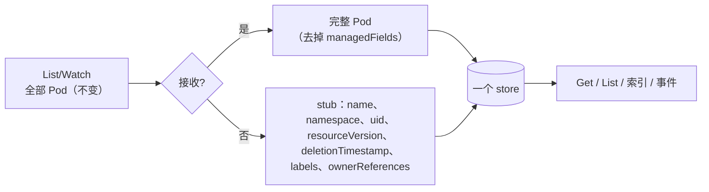

# KEP-284：基于 Transform Stub 的 Pod 缓存过滤

Issue: sgl-project/rbg#284

## 摘要

operator 的 Pod informer 会缓存集群中的每一个 Pod：`cacheOptions()` 用 `group-name` 标签限制了
Service、StatefulSet 和 Deployment 的缓存，但 Pod 没有过滤。共享集群里，这些内存大部分属于 RBG
不管理的 Pod。

本 KEP 保留单个 Pod informer 及其 watch，增加一个 `cache.ByObject` **Transform**。RBG 管理的
Pod（见[接收规则](#接收规则)）完整缓存，仅去掉 `managedFields`；其他 Pod 在进入缓存前被缩成
stub：name、namespace、UID、resourceVersion、deletionTimestamp、labels、ownerReferences，
不含 spec 和 status。仍然只有一个 watch、一个 store、一套索引和事件，所以缓存 `Get`、`List`、
字段索引、no-DeepCopy 读取、`Owns`/`Watches` 的行为与今天一致。按名存在性检查仍然走缓存，
因为无关 Pod 的名字还在。

Transform 由 `--pod-cache-scope=filtered` 启用；`all` 保持今天的缓存，是 alpha 默认值，beta 时
`filtered` 成为默认。`filtered` 下，Pod informer 还会在 reflector 存储 watch 事件之前转换它们。
如果 apiserver 支持 streaming list，且 operator 显式开启 client-go 的 `WatchListClient`
（默认关闭），启动和 relist 峰值可以随留存 store 一起下降；不支持 streaming list 时，
启动仍需要解码完整 List。

与缓存接收无关，RoleInstance 和 Warmup 在创建 Pod 时设置
`rbg.workloads.x-k8s.io/managed=true`。admin CLI 为存量 Pod 打标，默认作为 Helm 升级前的
hook 运行。标记不进入 workload 模板，因此存量 Pod 保持其 revision。

## 动机

共享集群中，缓存无关 Pod 的 spec 和 status 会浪费内存：operator 可能在大集群 OOM，小集群却正常。
RBG 管理的 Pod 已经带有三类标签之一（每个资源族引入一个），所以 operator 能在进程内区分它们；
缺的是一种在不改变缓存读取行为的前提下停止保留其余 Pod 的方法。

### 目标

- 只为 RBG 管理的 Pod 保留完整对象；无关 Pod 只保留一个小 stub。
- 存量工作负载不变：不改模板、不滚动更新、不协同升级，可见性也不依赖补标。
- 所有缓存读取路径仍然共用一个 informer、一个 store，语义与今天一致。
- 改动可在启动时切换，因此不需要回滚镜像就能关闭。
- 为 RBG 管理的 Pod 提供一个统一标记，在直接创建路径设置，并由 admin CLI 补标。
- 测量成本：留存堆、启动和 relist 峰值、同步时间、CPU 和 API 流量。

### 非目标

- 不减少 Pod watch 流量或 apiserver egress；Pod watch 保持不过滤，与今天一样。
- 不改变归属或接管规则；接收不授予接管 Pod 的权限。
- 不把标记写进任何 workload 模板（Deployment、StatefulSet、LeaderWorkerSet、
  RoleInstanceSet、RoleInstance），也不为添加标记而滚动工作负载。
- 不迁移 v1alpha1 API，不退役旧标签。
- Pod 缓存指标和采集所需的 controller RBAC 留到独立改动。
- 其他未过滤的 informer 另行跟踪：ConfigMap（由旧 discovery probe 通过缓存 client 启动）、
  CustomResourceDefinition 和 webhook 配置（webhook 证书 controller）、ControllerRevision、
  PodGroup。

## 方案

### 接收规则

满足**任意一个**条件的 Pod 会被完整缓存：

| 条件 | Pod 类别 |
| --- | --- |
| 存在标签 `rbg.workloads.x-k8s.io/group-name` | RBG 工作负载 Pod，包括受支持的原生工作负载 |
| 存在标签 `rbg.workloads.x-k8s.io/role-instance-name` | RoleInstance Pod，包括独立实例 |
| 存在标签 `workloads.x-k8s.io/warmup-name` | Warmup 执行 Pod |
| 标签 `rbg.workloads.x-k8s.io/managed` 等于 `true` | 统一标记 |
| 任一 ownerReference 的 API group 为 `workloads.x-k8s.io` | 引用 RBG 对象的 Pod，包括接收标签被移除的 RBG 受控 Pod |

带旧标签但 `managed=false` 的 Pod 仍然接收。接收在每个事件上对完整传入对象求值，所以条件可以
任意 OR，未来资源族只需带标记。接收决定缓存保留什么，不代表归属。

ownerReference 条件覆盖接收标签全部被移除的 Pod。今天这样的 Pod 仍会被 `getOwnedPods` 找到，
它按 ownerReference-UID 字段索引 List；接收任何引用 RBG 对象的 Pod 可以保持该行为。它也意味着
任何 stub 都不会带指向 RBG 对象的 ownerReference，因此按 owner 索引查找永远不会返回 stub。
如果只用 controller-only 条件，一个持有 RoleInstance 非 controller 引用的无关 Pod 会被缓存成
保留该引用的 stub，owner 索引 List 会返回它。

### 缓存实现

当 `--pod-cache-scope=filtered` 时，`cacheOptions()` 给 Pod 条目设置 transform，
`cache.Options.NewInformer` 只包装 `*corev1.Pod` informer 的 ListerWatcher；其他类型保持默认
构造。watch 事件在 reflector 看到之前经过同一个 transform 实例（见第 6 条）：

```go
&corev1.Pod{}: {Transform: podCacheTransform}
```

`all` 模式不安装任何 override。



1. **一个 informer，一个 store。** 没有 merge 层、墓碑、按来源游标或边界 GET。缓存 `Get`、
   `List`、`IndexField`、`Owns`/`Watches` 和 no-DeepCopy List 路径保持当前语义。
2. **Transform 幂等。** 使用 watch-stream wrapper（第 6 条）时，被 watch 的对象在 wrapper 里
   转换一次，进入 informer FIFO 时再转换一次。FIFO（`RealFIFO`、client-go
   `InOrderInformers` 下的默认实现，以及 `DeltaFIFO`）不会转换删除墓碑或 Sync delta，并要求
   transform 幂等（client-go v0.34.2，`tools/cache/the_real_fifo.go` 和 `delta_fifo.go`）。
   stub 再次进入仍是 stub，完整 Pod 也没有 `managedFields` 可再去。
3. **转换跟随事件。** 获得接收标签的 Pod 在下一次事件时完整存储；失去最后一个接收标签的 Pod
   被替换为 stub；引用 RBG 对象的 Pod 永远不会变成 stub。删除事件携带当时存储的形式。
4. **需要 Pod status 或 spec 的读取消费完整 Pod。** operator 中的缓存 Pod List 按 workload
   selector 或 ownerReference-UID 字段索引限定范围。StatefulSet reconciler 通常按要求
   `group-name` 的 selector List。被接管的 StatefulSet 可能保留另一个 selector，所以如果它的
   缓存 List 返回 stub，rollout 逻辑会用相同 namespace 和 selector 对 API server 重复该 List。
   RoleInstance owner 查找、Warmup 读取和 RBG 调度计数要求接收标签或指向 RBG 对象的
   ownerReference。node-name 读取使用这些 List 的 Pod。两个 Pod 事件源都通过 ownerReference
   把 Pod 映射到 RBG kind，所以 stub 不会入队。read-path 审计防止新增会把 stub 当完整 Pod
   解释的缓存 List。
   重启预算通过 RoleInstance selector 直接从 API 列出 Pod，并核对 controller UID。
5. **按名存在性检查仍留在缓存。** `getExistingPod` 能找到无关 Pod 的 stub，
   `metav1.IsControlledBy` 返回 false，controller 像今天一样报告名称冲突，不需要额外 API
   读取。Gang 调度的实例必须在创建任何 Pod 之前确认每个名称，也保持这一性质。
6. **启动和 relist。** 没有 streaming 时，reflector 在转换前解码完整 List。更小的留存 store
   可以降低 relist 峰值，但启动仍有完整 List 解码成本。使用 WatchListClient 且 server 支持时，
   reflector 在 initial-events-end bookmark 之前把流式对象收集到临时 store。在 client-go
   v0.34.2 中，只有实现完整 `Store` 接口的 store（`TransformingStore`）会把 transform 传给
   临时 store；informer FIFO 只实现 `ReflectorStore`。没有 wrapper 时，流式 Pod 在 `Replace`
   之前保持完整；诊断显示转换发生在 `Replace` 附近，堆峰值与全量缓存相当。在 reflector 之前
   转换 watch 事件也会缩小该临时 store。不支持的 server 回退到 List，wrapper 无法避免完整
   解码；两条路径都有测量。

#### Stub 字段

stub 保留 Pod 的身份（name、namespace、UID、resourceVersion、deletionTimestamp）、labels 和
ownerReferences，丢弃 spec 和 status。因此标签 selector 或 owner 检查对 stub 的求值与完整
Pod 相同，"这个名字是否被 RBG 不管理的 Pod 占用？"可以用今天的 metadata 回答。按接收规则，
stub 永远不会带接收标签或指向 RBG 对象的 ownerReference。

### 标记与补标

**创建路径。** RoleInstance 和 Warmup 在创建 Pod 对象时设置 `managed=true`。标记不进入
RoleInstanceSet 和 RoleInstance 模板，因此 revision hash 不受影响；Deployment、StatefulSet
和 LeaderWorkerSet 模板永远不打标；它们的 Pod 通过 `group-name` 接收。

**不做模板滚动更新。** Controller 和补标只修改 Pod 对象，不修改 workload 模板。模板比较保持原有
行为：用户显式添加、修改或删除模板里的标记时，reconciler 仍能看到该变更。回归测试覆盖模板和
Service 标签的差异。

**补标 CLI。** 存量 Pod 由 `kubectl rbg migrate pod-labels` 打标：

- 对每个旧 key，用服务端 selector `<legacy-key>,!rbg.workloads.x-k8s.io/managed` 列出候选，
  只 patch 标记。
- Patch 检查 UID 和当前标签，不使用 resourceVersion 前置条件，因此并发状态更新不会阻塞迁移，
  并发标签变化会重新检查；支持 `--dry-run`、限速和安全重跑。
- 不做 owner-chain 校验：旧标签已经标识 Pod，接收不代表归属。
- 只读 `check` 模式报告没有 `managed=true` 的 Pod 和 deprecated workload 模板，包括已显式设置
  非 `true` 值的 Pod。迁移保留已有标记值；operator 需要处理这些情况才能通过检查。这是
  controller 内后台任务无法提供的可观测完成标准。LeaderWorkerSet 未配置 leader 模板时沿用
  worker 模板，不会重复计数。
- Helm 默认作为 best-effort 的 pre-upgrade hook 运行。命令失败及剩余工作会写入日志，
  不会因此让 Job 失败。Helm 即使没有 `--wait-for-jobs` 也会等待 hook；如果 Job 无法启动
  或超时，升级仍可能失败。hook RBAC 在成功后清理；失败时的清理情况取决于 Helm 版本和失败
  环节。下次启用 hook 升级时会替换残留的 RBAC。Job 日志保留到配置的 TTL。manifest 安装以及
  禁用 hook 的升级需要手动运行 CLI。

deprecated workload 之后创建的 Pod 在下一次运行前保持未打标；`check` 会一直报告，直到这些
workload 迁移到 RoleInstanceSet。缓存可见性从不依赖标记，所以漏跑一次没有功能影响。本 KEP
中标记的消费者是接收规则；用标记单独退役旧标签条件是后续独立决策。

### 启用方式

chart 只在对应 option 启用时才传递缓存 flag。使用支持所选 flag、并在 Job 启用时包含迁移 CLI
的 controller 镜像。

| 设置 | 值 | 默认 | 效果 |
| --- | --- | --- | --- |
| `--pod-cache-scope`（Helm `controller.podCacheScope`） | `all`、`filtered` | alpha 为 `all`，beta 起 `filtered` | `all` 保持当前缓存；`filtered` 启用 Pod transform 和早期 watch wrapper |
| `--watch-list-client`（Helm `controller.watchListClient`） | `true`、`false` | `false` | 显式设置进程级 client-go `WatchListClient` gate；不支持的 server 回退到 List |

**Alpha 默认 `all`。** 同源原型现在有 macOS 和 Linux 容器结果，所有测量形状的留存堆都更低。
这些是 arm64 合成测试，生产 read-path 审计、支持版本、升级 e2e 和目标规模 cgroup 内存/
working set 仍是毕业标准。CPU 和启动峰值随环境变化；测量不承诺零开销。

**WatchListClient 仍是独立 opt-in。** 它会改变进程中每个 informer。server 支持时，早期 watch
wrapper 会大幅降低共享形状的 Pod 启动峰值。CPU 和同步时间成本在 macOS 与 Linux 上不同，因此
要在目标环境评估（见[实测样本](#实测样本)和[性能实测](performance.md)）。其默认值将在 beta
结合支持的 Kubernetes 版本重新讨论。

**显式设置有效 gate。** operator 的生产依赖会到达 `k8s.io/kubernetes/pkg/features`，它替换了
client-go 读取环境变量的 gate。因此仅设置 `KUBE_FEATURE_WatchListClient` 在当前 operator
依赖链中不会启用 streaming。解析 `--watch-list-client` 后，实现必须在构造 client 或 informer
之前调用 `utilfeature.DefaultMutableFeatureGate.Set("WatchListClient=<true|false>")`，设置
失败时返回错误。harness 验证了该机制和有效值；其环境变量由 `TestMain` 显式转换。

### 风险及处理

| 风险 | 处理 |
| --- | --- |
| 未来的 Pod List 把 stub 当作完整 Pod 使用 | read-path 审计作为 alpha 标准；对限定范围的 Pod List 和 StatefulSet API 回退进行回归测试 |
| RBG Pod 未被接收 | 接收规则覆盖三个旧标签、标记和任何指向 RBG 对象的 ownerReference；创建路径测试 |
| 模板里的标记滚动存量 Pod | 不写进模板；测试确认模板标签差异仍可被检测 |
| List 启动仍解码全部 Pod | 按测量区间做预算；server 支持时，可选 WatchListClient 和早期 watch wrapper 降低共享形状峰值 |
| transform 缺陷隐藏 Pod 数据 | `--pod-cache-scope=all` 重启即恢复今天的缓存；每个接收条件和幂等性都有单测 |
| 补标对 apiserver 的压力 | 服务端 selector、限速、`--dry-run`；启用后每次升级运行一次 |

## 设计细节

### 测试计划

下面点名的原型测试在[性能实测](performance.md)描述的 harness 中。以下是生产集成测试计划；
实际覆盖范围以仓库测试及其结果为准。

#### 单元测试

- Transform：每个接收条件单独和组合、`managed=false`、controller 与非 controller 引用 RBG
  kind、外部 controller、非 Pod 输入、去掉 `managedFields`、stub 内容、幂等性（原型：
  `TestTransformIsIdempotent`）。
- Drift：`podTemplateSpecEqual` 和 workload metadata 仍会检测标记及其他标签的变化。
- CLI：每个旧 key 的候选选择、`--dry-run`、UID 前置条件、冲突重试、限速和 `check` 输出。
- Watch wrapper：Add/Modify/Delete、bookmark/error 不变、空闲和 pending-send Stop 的确定性
  loop-exit 检查；有效 WatchListClient 设置和恢复。

#### 集成测试

- 接收和 stub：缓存 `Get` 对接收 Pod 返回完整对象，否则返回 stub；标签限定的 List（深拷贝和
  不深拷贝）绝不返回 stub；owner 索引能找到引用 RBG 对象但没有接收标签的 Pod，且绝不返回
  stub（原型：`TestAPITransformAdmissionAndStubs`）。
- 转换和事件：未接受到接收再回来；引用 RBG 对象的 Pod 失去标签后仍保持完整；两种形式的删除
  事件（原型：`TestAPITransformTransitionsAndEvents`）。
- 被移除所有接收标签的 owned Pod 仍由 `getOwnedPods` 返回，RoleInstance 不会少算或尝试替换它。
- 保留的 selector 匹配 stub 的 StatefulSet 通过相同 namespace 和 selector 读取完整 Pod，并
  推进其 rollout partition。
- 归属冲突：同名无关 Pod 作为 stub 被发现，controller 报告冲突，不产生 Create→AlreadyExists，
  也不多一次 API 读取。
- streaming list、回退到 List、watch 过期（410）后的 relist，覆盖 apiserver `WatchList` 开和
  关（原型：transform 对比）。开启 streaming 和 watch-stream wrapper 时，每个 Pod 在
  reflector 临时 store 之前被转换，启动堆峰值跟随留存 store（原型：
  `TestAPITransformSyncHeapTimeline` 和 `transform-*-stream` 模式）。
- watch 断开期间，在注入 410 前修改接收标签，然后验证替换快照的 Pod 形式和 resourceVersion
  （`TestAPITransformRelist`）。
- `--pod-cache-scope=all` 复现今天的缓存。

#### e2e 测试

- 从上一版本升级，已有 Deployment、StatefulSet、LeaderWorkerSet 和 RoleInstanceSet 工作负载
  产生零模板 diff、零 Pod 重启。
- RoleInstance、Deployment、StatefulSet、LeaderWorkerSet（leader 和 worker）和 Warmup 创建
  的 Pod 完整接收；Warmup 动作和超时不受影响。
- 升级后立即回滚，存量 Pod 保持可见。双向切换 `--pod-cache-scope` 时，Pod、模板和 revision
  保持不变。
- Helm pre-upgrade hook 在新 controller 启动前为存量 Pod 打标。`check` 报告完成情况和仍在
  产出未打标 Pod 的 deprecated workload。补标命令失败时记录告警，升级继续。若 Job 无法
  启动，升级会停止；重试成功后会清理临时 RBAC。

### 毕业标准

#### Alpha

- `--pod-cache-scope` 默认 `all`；`filtered` 启用 transform 和 Pod informer 的 watch-stream
  wrapper。Helm 在[启用方式](#启用方式)暴露两个设置，`WatchListClient` 默认关闭。
- Pod read-path 审计记录在实现 PR 中，并有回归测试。
- RoleInstance 和 Warmup 在创建的 Pod 上打标，不修改模板；模板标签比较保持原有行为。
- `kubectl rbg migrate pod-labels` 支持 `check`、`--dry-run` 和限速，并有 Helm pre-upgrade hook。
- 单元和集成测试入库；升级 e2e 确认零模板 diff。

#### Beta

- `filtered` 成为默认，有 Linux 容器目标规模测量支撑（cgroup 内存和 working set），包括
  streaming list 开/关的 relist 峰值。
- 支持的 Kubernetes 版本、`WatchListClient` 默认值和 `DefaultNamespaces`（controller-runtime
  的多 namespace informer 目前无法通过 no-DeepCopy helper 的类型断言）已确定并覆盖。
- alpha 期间没有接收遗漏事故。

#### GA

- 一个 release 以 `filtered` 为默认，且没有 Pod 可见性事故。
- 基于 `check` 报告，退役旧标签条件的决策已记录。

### 预期效果

留存内存 $M \approx B + R\,S + (N - R)\,s$，其中 $N$ 为全部 Pod，$R$ 为接收 Pod，$S$ 为
完整 Pod 的平均留存成本，$s$ 为 stub 成本，$B$ 为其他留存堆。今天是 $B + N\,S$。节省为
$(N - R)(S - s)$，因此收益随无关 Pod 占比增长；没有无关 Pod 时，transform 除了每事件 CPU
外没有额外成本。

#### 实测样本

2026-11-01 在 macOS arm64 和离线 Linux arm64 容器上测量，使用同源原型、Go 1.26.0 和
`GOMAXPROCS=4`。隔离控制面为 Kubernetes v1.31.0 / etcd 3.5.15；合成未调度 Pod 包含 64 个
512 字节环境变量。五种形状，每种 server 配置和平台三轮轮换：240 个缓存进程通过。

中位数，单位 MiB。`filtered` 包含选定的 stub **和早期 watch wrapper**。留存堆是两次 GC 后的
整进程 `HeapAlloc`。启动 RSS 是同步后两秒的内核生命周期峰值，窗口内不显式 GC。Heap 和 List
列使用 List-server 批次；streaming 列都使用启用 server streaming 的 WatchListClient。区间、
CPU、relist、复现命令和覆盖限制见[性能实测](performance.md)。

| 平台 | 相关 / 无关 Pod | 留存堆：full / union / filtered | List 启动 RSS：full / union / filtered | Streaming 启动 RSS：full / store-only transform / filtered |
| --- | --- | --- | --- | --- |
| macOS arm64 | 48 / 1,000 | 47.31 / 5.20 / 6.61 | 124.38 / 51.02 / 125.30 | 99.69 / 103.05 / 45.39 |
| macOS arm64 | 900 / 100 | 45.41 / 42.06 / 37.03 | 120.33 / 186.27 / 120.59 | 98.31 / 101.34 / 90.89 |
| macOS arm64 | 1,000 / 0 | 45.42 / 46.32 / 40.61 | 120.73 / 202.12 / 120.64 | 101.20 / 100.89 / 90.50 |
| macOS arm64 | 200 / 4,800 | 214.04 / 11.74 / 18.84 | 672.22 / 74.66 / 677.70 | 337.81 / 346.66 / 70.61 |
| macOS arm64 | 5,000 / 0 | 214.70 / 218.46 / 190.63 | 675.73 / 800.97 / 675.94 | 341.80 / 344.81 / 325.47 |
| Linux arm64 | 48 / 1,000 | 47.30 / 5.20 / 6.60 | 172.15 / 56.69 / 130.77 | 108.52 / 108.88 / 55.86 |
| Linux arm64 | 900 / 100 | 45.40 / 42.08 / 37.02 | 166.71 / 186.53 / 166.64 | 103.61 / 107.74 / 99.16 |
| Linux arm64 | 1,000 / 0 | 45.41 / 46.31 / 40.60 | 166.57 / 205.65 / 126.01 | 105.53 / 104.74 / 100.58 |
| Linux arm64 | 200 / 4,800 | 214.02 / 11.73 / 18.83 | 677.64 / 80.00 / 628.00 | 372.54 / 358.43 / 84.09 |
| Linux arm64 | 5,000 / 0 | 214.69 / 218.45 / 190.62 | 681.05 / 872.17 / 631.20 | 367.69 / 359.53 / 337.25 |

- **共享形状留存堆：** 两个平台在 48 / 1,000 约降 86%，在 200 / 4,800 约降 91.2%。没有无关
  Pod 时，约 11% 的收益来自去掉 `managedFields`，全量缓存也可以独立采用。
- **List 启动仍解码每个 Pod。** RSS 随 GC 时机变化；这些样本不能用接收 Pod 数界定启动内存。
  GC 后更低的堆不意味着 RSS 立即回收。
- **Streaming 需要 wrapper：** 200 / 4,800 时，store-only transform 峰值
  346.66 / 358.43 MiB（macOS / Linux），早期转换后为 70.61 / 84.09 MiB。
- **200 / 4,800 的 relist：** List full / filtered 峰值 footprint 在 macOS 为
  994.0 / 649.3 MiB，Linux 为 879.2 / 644.3 MiB；streaming full / filtered 为
  599.0 / 79.9 MiB 和 606.5 / 84.6 MiB。macOS footprint 与 Linux 采样 RssAnon 定义不同；
  只在同一平台内比较。relist 获取时间不含重连退避和后续缓存处理，由变更快照集成测试单独验证。
- **CPU 成本依赖环境：** 同一 streaming-server 批次 200 / 4,800 中，全量缓存启动 CPU 在
  macOS 开启 WatchListClient 后从 345 → 1,322 ms，在 Linux 为 715 → 515 ms。之前通用的
  CPU / 同步时间倍率已移除。Transform 保留完整 Pod watch 及其解码后的 payload 流量。
- **Union 取舍：** 在稀疏共享形状中它留存更少堆、读取更少字节。基准给每个相关 Pod 全部四个
  标签，是最大重叠场景；其重复读取和时序结果只适用于该形状。选择 transform 是因为单 store
  读取语义和更小的正确性面，而不是普遍的资源优势。

### 可扩展性

- **Watch 和流量：** 一个未过滤 Pod watch。同一协议内，实测解码响应字节与全量缓存相同。
  压缩后的 wire 字节和稳态事件吞吐未测量。
- **启动：** 一次完整 List，或在显式启用 WatchListClient 且 server 支持时使用 streaming
  list。普通 List 保留完整解码内存成本；streaming 需要早期 wrapper。
- **同步预算：** 已发布的 [200 / 4,800 运行](performance.md#startup-detail-200-related--4800-unrelated)
  中，选定 wrapper 的同步为 344–807 ms。这些本地测试不确立目标规模延迟，也不构成
  100,000 Pod 的线性预测。保留缓存同步超时，并对真实集群验证。
- **内存：** 完整接收 Pod 加每个无关 Pod 一个 metadata stub；labels 和 ownerReferences 影响
  stub 大小。容器内存/working set 和 OOM 行为仍是 beta 测量。内存受限的 `filtered` 部署应把
  软 `GOMEMLIMIT` 设在容器 limit 以下，给非 Go 内存留空间，然后验证启动和 relist 峰值。
- **CPU：** 每个 List item 一次 transform，早期 wrapper 下每个被 watch 对象两次。启动和
  relist 结果因平台而异；持续事件 churn 仍需测量。
- **写入：** controller 只在创建时打标；限速 CLI patch 存量 Pod。
- **读取：** 按名存在性检查仍走缓存。StatefulSet rollout 在缓存 List 含 stub 时发起一次限定
  范围的 API List。

### 升级、回退与版本偏差

- **升级：** `all`（alpha 默认）下缓存不变。`filtered` 下带旧标签的 Pod 立即接收。两种方式都
  不改模板、不滚动更新。
- **回退：** 旧镜像缓存全部 Pod 并忽略标记，标记是无害 metadata。
- **切换 scope：** 用另一个值重启会重建缓存；没有持久化状态。
- **Operator 副本：** 每个进程维护自己的缓存；只有 leader 协调。
- **Kubernetes 版本：** transform 在所有支持版本上工作。Streaming list 依赖 apiserver 的
  `WatchList` 特性，其默认值跨版本变化；server 不提供时 client 回退到 List。支持矩阵是
  beta 标准。

在升级后的版本通过 v1alpha1 API 写入时，旧 LeaderWorkerSet 角色的 `restartPolicy: None`
可能改存为 `restartPolicyConfig.type: None`。v0.7.0 只读取旧字段，此时降级可能将渲染出的
LeaderWorkerSet 策略改为 `RecreateGroupOnPodRestart`，触发 Pod 滚动。关闭缓存过滤和补标时
也会出现这个行为。只需关闭过滤时，可在当前版本设置 `controller.podCacheScope=all`。

## 生产就绪评审问卷

### 功能启用与回退

###### 如何在运行中的集群启用 / 禁用该功能？

- [x] 其他
    - 机制：operator flag `--pod-cache-scope=all|filtered`，通过 Helm value
      `controller.podCacheScope` 暴露。`all` 保持今天的缓存，是 alpha 默认；`filtered` 启用
      transform。
    - 是否需要控制面停机？不需要。
    - 是否需要节点停机或重新配置？不需要；operator 重启，运行中的工作负载不重启。

###### 启用后是否改变默认行为？

工作负载行为不变：Pod 创建、更新、删除、就绪、Warmup 超时和 RBG status 都不变。`filtered` 下
operator 为无关 Pod 保留 stub。与 flag 无关，RoleInstance 和 Warmup 创建的 Pod 带
`managed=true`，CLI 为存量 Pod 添加。没有 API 或 CRD 变化。

###### 启用后能否禁用？

可以：用 `--pod-cache-scope=all` 重启 operator。CLI 写入的标签保留并被忽略。

###### 回滚后重新启用会发生什么？

缓存启动时 transform 再次生效；运行之间没有持久化状态。

###### 有没有启用 / 禁用的测试？

双向切换 `--pod-cache-scope`，以及带旧标签 Pod 的升级和回退，都是 alpha 标准。

## 实现历史

- 2026-10-28：创建 KEP，采用四路标签并集和 controller 内补标。
- 2026-10-29：补齐 KEP 模板章节；并集在 merge 记录和业务索引之间共享不可变 Pod 对象。
- 2026-10-30：串行四路初始化、启动测量、未缓存按名读取要求、alpha 毕业标准和回退章节。
- 2026-10-31：按评审修改。设计改为单 informer + transform stub，位于
  `--pod-cache-scope` 之后；补标移到 admin CLI；标记不进入 workload 模板。并集设计移到
  [备选方案](#备选方案)，两个设计用同一 harness 测量
  （[`test/podcacheunion`](https://github.com/sgl-project/rbg/tree/d7c487138ee89b746c4b92a88b6704fa8b1eb25f/test/podcacheunion)，
  在 `kep-284-e2e-test` 分支）。
- 2026-11-01：确定 alpha 默认：`--pod-cache-scope=all`，beta 改为 `filtered`，
  `WatchListClient` 关闭。stub 保留 labels 和 ownerReferences，ownerReference 接收条件覆盖
  任何指向 RBG 对象的引用。
- 2026-11-01：在 macOS 和离线 Linux 容器验证选定的 watch wrapper；240 个缓存进程通过。
  更新测量区间和平台相关 CPU 结果，WatchList 启用方式改为显式有效 gate 设置。
- 2026-11-03：把原型 harness 移到 `kep-284-e2e-test` 分支（#545）。
- 待定：实现 PR。

## 缺点

- **无关 Pod 仍各占一个 stub，且仍有完整 watch 流。** 留存内存仍随全部 Pod 增长，只是按
  stub 的速率。
- **普通 List 保留完整解码的启动成本。** Streaming list 是 opt-in；没有该路径时，启动内存
  不能由接收 Pod 数界定。
- **watch-stream wrapper 是对 client-go 的 workaround。** 它存在是因为 client-go v0.34.2
  不把 informer transform 传给 streaming-list 临时 store；client-go 支持后应移除。
- **无关 Pod 事件仍会运行事件 handler。** 其完整输入仍要解码和分发；持续事件负载成本未在此
  测量。
- **正确性依赖限定读取。** 未来未限定范围的 Pod List 会静默看到 stub；审计和回归测试用于
  防护。
- **标记会成为事实上的公开接口，** manifest 安装需要一次性 CLI 运行。

## 备选方案

每个备选方案都按实现复杂度、与现有工作负载的兼容性和升级影响权衡。决定性的对比——四路
并集——与 transform 用同一 harness 测量。

- **带 merge 层的四路标签并集（本 KEP 的上一版）。** 四路服务端过滤 List/Watch 需要
  resourceVersion 排序、删除水位、按来源游标、边界 GET、miss 确认和串行初始化。它不保留
  无关 stub，在稀疏共享形状中堆和响应字节占优。**不采纳**，因为它扩大了
  Get/List/索引/事件/no-copy 的正确性面，且仍留下 owner 索引和按名读取的兼容缺口。多个匹配
  selector 还会重复解码；当前最大重叠测量显示了该成本，但不声称适用于所有工作负载组合。

  在 5,000 / 0 时，其 List 启动 RSS 在 macOS 为 800.97 MiB，全量缓存 675.73 MiB；Linux 为
  872.17 对 681.05 MiB。在 200 / 4,800 时，它的 List 启动峰值低得多，为
  74.66 / 80.00 MiB，而选定 transform 开启 streaming 后为 70.61 / 84.09 MiB。这些测量取舍
  和区间记录在[性能实测](performance.md)。

- **互斥 selector 分区。** 并集的一个变体（例如 `role-instance-name` 存在且 `group-name`
  不存在），通过构造消除重复解码，代价是 live Pod 接收标签变化时更多边界转换。**与并集一起
  不采纳**：它保留 merge 层，而单 informer 没有重叠可消除。
- **只用旧标签，不用标记。** 三路并集。**不采纳：** 与并集相同的 merge 成本，且每个新创建
  路径都要改缓存规则。在 transform 下接收是进程内代码，但标记仍让新路径免于该改动。
- **全量 metadata informer 做发现 + 过滤后的完整对象 informer。** 两份视图要保持一致。
  **被取代：** transform 用一个 store 给出相同留存。
- **有界逐页合并。** `ListPager.EachListItemWithAlloc` 已经流式处理分页 item，带页面缓冲、
  续查处理和取消。剩余工作是把这些回调接入 union store、发布一致的替换快照，并在页面或
  watch 过期时限制恢复 relist。**与并集一起不采纳：** 选定的 streaming transform 避免了这套
  merge/snapshot 机制。在仅 List 的 server 上仍要付完整 List 解码成本；仅靠现有分页 API
  不会让 informer `Replace` 增量。
- **在 leader 内补标（上一版）。** 为一次性迁移保留永久后台 writer，带 owner-chain 校验且
  没有可观测完成。**不采纳**，改用带 `check` 的 CLI。
